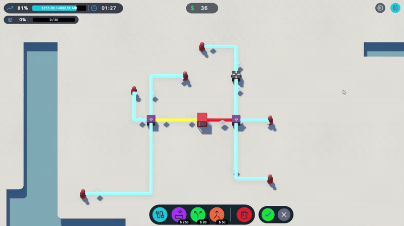
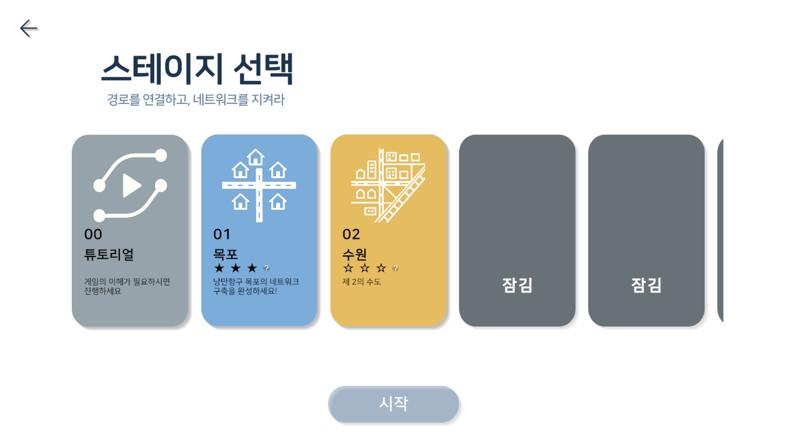
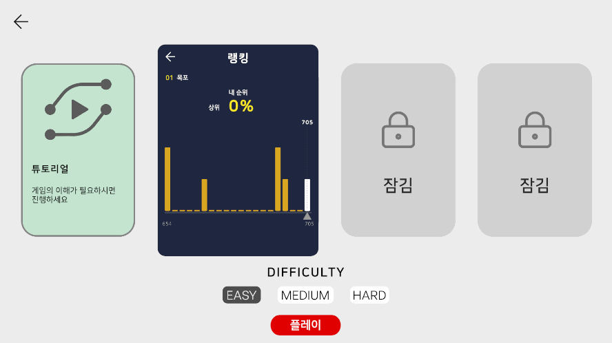
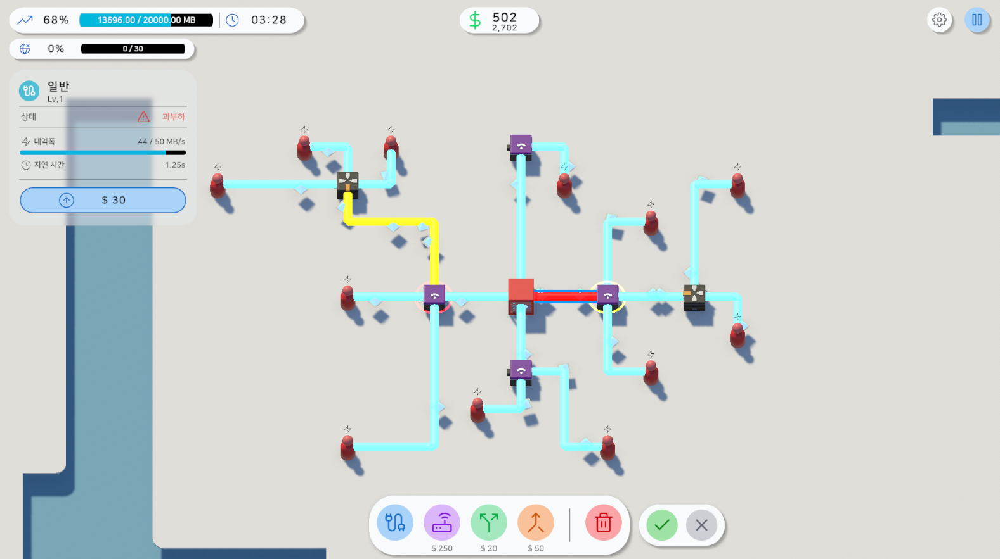
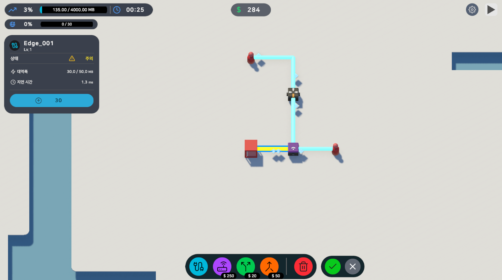
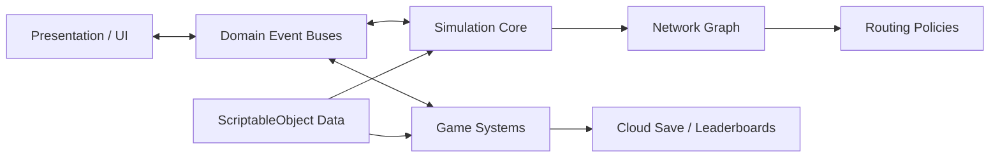

# EndGame — Network Infrastructure Simulator

> 제한된 예산으로 네트워크 인프라를 설계하고 증가하는 트래픽을 처리하는 Unity 기반 전략 시뮬레이션 게임입니다.

  

  네트워크를 구축하고 실시간 트래픽을 처리하는 핵심 게임플레이

[원본 프로젝트 저장소](https://github.com/parkwonkuku/2026_GraduationProject) · [아키텍처](docs/architecture.md) · [문제 해결 사례](docs/case-studies.md)

## 프로젝트 개요

플레이어는 네트워크 사업자가 되어 라우터, 서버, 스플리터, 머저를 배치하고 케이블로 연결합니다. 사용자가 만든 트래픽은 패킷 단위로 네트워크를 이동하며, 대역폭과 라우팅 상태에 따라 전달되거나 유실됩니다.

- **엔진:** Unity 6000.3.6f1, URP 17.3
- **언어:** C#
- **플랫폼:** Windows Standalone
- **협업:** 4명의 커밋 기여자, 총 552개 커밋, PR 기반 개발
- **본인 기여:** 284개 커밋 — 시뮬레이션 코어 및 게임 시스템 중심

## 핵심 게임플레이

1. 제한된 예산으로 네트워크 노드와 케이블을 배치합니다.
2. 트래픽 혼잡과 패킷 유실을 관찰하며 인프라를 확장하거나 업그레이드합니다.
3. DDoS, 트래픽 버스트, 링크 장애에 대응합니다.
4. 목표 전송량을 달성하면 승리하고 처리율·지출·시간을 바탕으로 점수를 기록합니다.

## 게임 화면

<table>
  <tr>
    <td width="50%" align="center">
      
       
      <b>스테이지와 난이도 선택</b> 
      목표를 선택하고 난이도별 네트워크 구축에 도전합니다.
    </td>
    <td width="50%" align="center">
      
       
      <b>스테이지 랭킹</b> 
      플레이 결과와 리더보드 내 순위를 확인합니다.
    </td>
  </tr>
  <tr>
    <td width="50%" align="center">
      
       
      <b>네트워크 구축</b> 
      노드와 케이블을 배치해 트래픽 전달 경로를 설계합니다.
    </td>
    <td width="50%" align="center">
      
       
      <b>실시간 상태 확인</b> 
      처리량과 지연 시간을 확인하고 혼잡 구간을 개선합니다.
    </td>
  </tr>
</table>

## 주요 시스템

| 시스템 | 구현 내용 |
|---|---|
| 네트워크 시뮬레이션 | 0.1초 고정 틱, 노드·엣지·포트·패킷·트래픽 모델 |
| 라우팅 | `INextHopPolicy` 기반 라운드로빈·최적 상태 정책 교체 |
| 경제·미션 | 건설 비용, 예산, 목표 전송량과 실패 트래픽 추적 |
| 장애 이벤트 | ScriptableObject 기반 DDoS·트래픽 버스트·링크 장애 |
| 교육 요소 | 플레이 상황에 반응하는 네트워크 용어 도감과 튜토리얼 |
| 온라인 기능 | Unity Cloud Save와 Leaderboards 기반 진행도·랭킹 |
| 접근성 | 한국어·영어 UI, 입력 키 리바인딩 |

## 담당 영역

### 네트워크 시뮬레이션 코어

- 노드, 엣지, 포트, 패킷, 트래픽 모델 설계
- 라우터·서버·스플리터·머저·사용자 노드 구현
- 패킷 전송, 대역폭, 혼잡, 유실 처리
- 프레임레이트와 분리된 고정 틱 시뮬레이션 루프

### 게임 시스템

- 경제 시스템과 미션 승패 판정
- 점수 계산과 스테이지별 랭킹
- 네트워크 장애 이벤트와 저장 기반 진행도
- 트래픽·패킷 오브젝트 풀링

### 아키텍처와 UI

- 도메인별 이벤트 버스로 UI와 시뮬레이션 의존성 분리
- 노드 상태 패널, 스테이지 선택, 랭킹 백분위 UI
- Unity Cloud Save와 Leaderboards 연동

## 기술적 설계

자세한 구조와 선택 이유는 [아키텍처 문서](docs/architecture.md), 구현 중 해결한 문제는 [문제 해결 사례](docs/case-studies.md)에서 확인할 수 있습니다.

## 사용 기술

- **Engine & Rendering:** Unity 6.3, URP, Tilemap, Splines, ProBuilder
- **Gameplay:** Input System, Timeline, DOTween, ScriptableObject
- **Backend:** Unity Authentication, Cloud Save, Leaderboards
- **Collaboration:** Git, GitHub branches, pull requests
