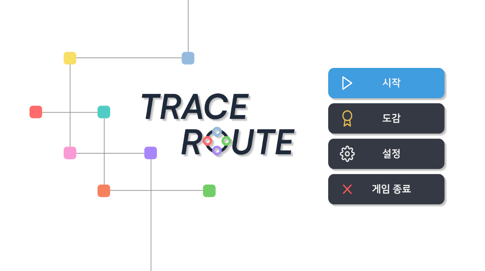
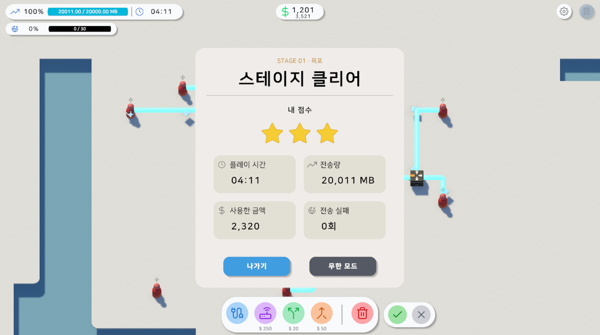
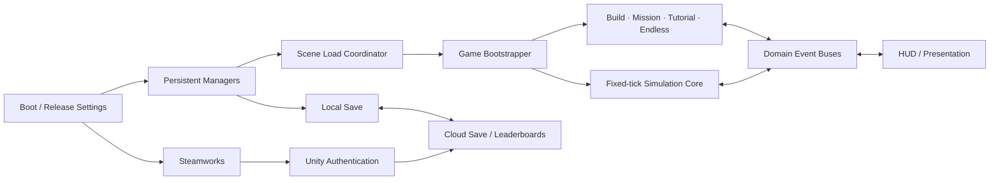

# Traceroute — Network Infrastructure Simulator

> 제한된 예산으로 통신망을 설계하고, 실시간 트래픽과 장애에 대응하는 Unity 기반 네트워크 전략 시뮬레이션 게임입니다.

  

  <a href="https://store.steampowered.com/app/5152640/">Steam에서 무료 데모 플레이</a>
  ·
  <a href="https://store.steampowered.com/app/5082920/">본편 Steam 페이지</a>

[아키텍처](docs/architecture.md) · [문제 해결 사례](docs/case-studies.md)

## 프로젝트 개요

플레이어는 네트워크 사업자가 되어 라우터, 서버, 분배기, 병합기와 케이블을 배치합니다. 사용자가 만든 트래픽은 패킷 단위로 네트워크를 이동하며, 플레이어는 대역폭·지연 시간·예산을 함께 관리하면서 트래픽 버스트와 DDoS 같은 돌발 상황을 견뎌야 합니다.

- **엔진:** Unity 6000.3.6f1, URP 17.3
- **언어:** C#
- **플랫폼:** Windows / Steam
- **협업:** 4명의 커밋 기여자, 총 657개 커밋, PR 기반 개발
- **본인 기여:** 355개 커밋 — 시뮬레이션 코어, 건설 시스템, 저장·온라인 서비스, 출시 런타임 중심

## 출시 정보

- **게임명:** Traceroute
- **개발·퍼블리싱:** Tiny Signal
- **Steam 데모:** 2026년 8월 29일 출시, 무료 플레이 가능
- **본편:** Steam 상점 공개, 출시 예정
- **지원 언어:** 한국어, 영어

데모와 본편은 서로 다른 Steam App ID와 콘텐츠 제한을 사용하며 하나의 코드베이스에서 빌드됩니다. 상용 프로젝트이므로 실행 파일과 전체 소스 코드는 공개하지 않고, 이 저장소에서는 담당 영역과 기술적 의사결정, 문제 해결 과정, 실제 플레이 화면을 소개합니다.

## 핵심 게임플레이

1. 제한된 예산으로 네트워크 노드와 케이블을 배치합니다.
2. 실시간 처리량과 지연, 과부하 구간을 관찰하며 장비를 증설하거나 업그레이드합니다.
3. 트래픽 버스트, DDoS, 링크 장애에 대응합니다.
4. 목표 전송량을 달성하고 실패 트래픽·지출·시간 조건에 따라 최대 별 3개를 획득합니다.
5. 스테이지 클리어 후 무한 모드와 온라인 랭킹에 도전합니다.

## 게임 화면

<table>
  <tr>
    <td width="50%" align="center">
      
       
      <b>스테이지 선택</b> 
      지역별 목표와 해금 상태를 확인합니다.
    </td>
    <td width="50%" align="center">
      
       
      <b>난이도·랭킹</b> 
      난이도를 고르고 리더보드 내 백분위를 확인합니다.
    </td>
  </tr>
  <tr>
    <td width="50%" align="center">
      
       
      <b>실시간 네트워크 운영</b> 
      망을 확장하고 장비 상태와 병목을 즉시 확인합니다.
    </td>
    <td width="50%" align="center">
      
       
      <b>스테이지 결과</b> 
      별 등급과 플레이 시간, 전송량, 지출, 실패 횟수를 집계합니다.
    </td>
  </tr>
</table>

## 주요 시스템

| 시스템 | 구현 내용 |
|---|---|
| 출시 런타임 | Boot 씬에서 데모·본편 App ID, 콘텐츠 제한, 전역 매니저 초기화 순서 관리 |
| 네트워크 시뮬레이션 | 0.1초 고정 틱, 노드·엣지·포트·패킷·트래픽 모델 |
| 건설 트랜잭션 | 배치 검증, 비용 미리보기·결제·환불·업그레이드와 그리드 상태를 단일 서비스에서 처리 |
| 라우팅 | `INextHopPolicy` 기반 라운드로빈·최적 상태 정책 교체 |
| 스테이지·무한 모드 | 난이도별 목표, 별 등급, 동적 난이도와 개인 최고 점수 |
| 튜토리얼 | 실제 그래프 연결·색상 경로·부하 안정성을 판정하는 단계형 실습 |
| 저장·온라인 | 로컬 우선 저장, 실패 업로드 재시도, Steam 계정 기반 Cloud Save·Leaderboards |
| 접근성 | 한국어·영어 UI, 입력 키 리바인딩, 난이도 선택 |

## 담당 영역

### 시뮬레이션·건설 코어

- 노드, 엣지, 포트, 패킷, 트래픽 모델과 고정 틱 루프 설계
- 라우터·서버·분배기·병합기·사용자 노드와 교체 가능한 라우팅 정책 구현
- 케이블 초안부터 확정, 업그레이드, 철거까지 비용과 상태를 일관되게 처리하는 트랜잭션 계층 구현
- 대역폭, 혼잡, 지연, 패킷 유실과 오브젝트 풀링 처리

### 게임·교육 시스템

- 난이도별 경제·미션·별 등급과 스테이지/무한 모드 결과 흐름
- DDoS·트래픽 버스트·링크 장애와 저장 기반 진행도
- 사용자 행동이 아니라 실제 네트워크 완성 상태를 검사하는 튜토리얼 조건 평가기
- 노드 상태 패널, 스테이지 선택, 랭킹 백분위, 결과 UI

### 출시·온라인 서비스

- 데모·본편 설정을 분리한 Steam 초기화와 콘텐츠 게이팅
- Steam Web API 인증 티켓을 Unity Authentication에 연결
- 로컬 저장을 유지하면서 Cloud Save 실패를 다음 실행에 재시도하는 동기화 흐름
- Unity Leaderboards 기반 스테이지·난이도별 랭킹

## 기술적 설계

자세한 구조와 선택 이유는 [아키텍처 문서](docs/architecture.md), 출시 과정까지 포함한 구현 문제와 해결은 [문제 해결 사례](docs/case-studies.md)에서 확인할 수 있습니다.

## 사용 기술

- **Engine & Rendering:** Unity 6.3, URP, Tilemap, Splines, ProBuilder
- **Gameplay:** Input System, Timeline, DOTween, ScriptableObject
- **Platform:** Steamworks
- **Backend:** Unity Authentication, Cloud Save, Leaderboards
- **Collaboration:** Git, GitHub branches, pull requests
