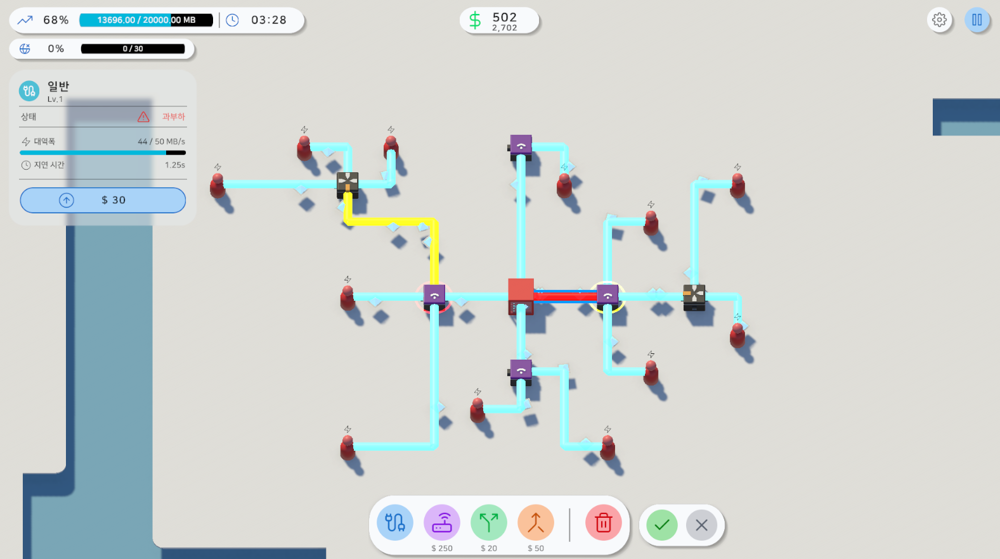

# Traceroute

**패킷 처리와 비동기 상태의 일관성**

제한된 예산으로 네트워크를 구축하고 트래픽 병목과 장애에 대응하는 Unity 기반 전략 시뮬레이션 게임입니다.

[포트폴리오 PDF 보기](docs/portfolio.pdf) · [Steam 정식 버전](https://store.steampowered.com/app/5082920/Traceroute/) · [코드 읽는 순서](docs/code-guide.md) · [문제 해결 과정](docs/case-studies.md) · [아키텍처](docs/architecture.md)



## 프로젝트 개요

| 구분 | 내용 |
|---|---|
| 개발 기간 | 2026.02 - 2026.10 |
| 개발 인원 | 4명 / 기획 1, 아트 1, 클라이언트 2 |
| 담당 업무 | 팀장, 시뮬레이션 코어·저장·온라인 서비스 연동 |
| 출시 | Steam 정식 출시 완료 |
| 엔진·언어 | Unity, C# |
| 온라인 서비스 | UGS Authentication / Cloud Save / Leaderboards, Steamworks |
| 협업 | Git 브랜치, Pull Request 리뷰 |

사용자가 만든 트래픽은 여러 패킷으로 나뉘어 노드와 전송 경로를 이동합니다. 아래에서는 기능 수보다 틱 안의 처리 순서, 만료 뒤 자원 회수 조건, 로컬 저장과 비동기 응답의 경계를 설명합니다.

## 본인 기여

4인 팀에서 팀장과 클라이언트 개발을 맡았으며, 담당 범위는 시뮬레이션 코어·저장·온라인 서비스 연동입니다. 아래 사례는 해당 담당 범위에서 선별한 구현입니다.

| 사례 | 해결해야 했던 문제 | 설계 판단과 코드 근거 |
|---|---|---|
| TTL 만료와 패킷 회수 분리 | 만료 순간 패킷을 제거하면 대기열 점유까지 사라져 병목이 저절로 해소됨 | 실패 통지는 한 번만 발행하고, 개별 패킷은 도착·드롭 시 회수. 모든 패킷 해결 뒤 트래픽 회수 |
| 비동기 저장 응답의 버전 검사 | 저장 A 업로드 중 저장 B가 발생하면 A의 늦은 응답이 최신 저장까지 동기화된 것처럼 표시할 수 있음 | 로컬 저장 버전을 증가시키고 현재 버전과 일치하는 요청만 pending 상태 갱신 |

TTL 사례는 플레이어가 병목을 발견하고 네트워크를 개선해야 한다는 기획 의도를 코드의 처리 조건으로 옮긴 경험입니다. 저장 사례는 로컬 기록, 업로드 요청, 응답 반영을 분리해 비동기 실행 순서에 대응한 경험입니다.

[TTL 처리 조건과 코드](docs/troubleshooting/traffic-expiration-lifecycle.md) · [저장 요청 순서와 보장 범위](docs/troubleshooting/async-save-versioning.md) · [검증 근거](docs/evidence.md) · [플레이 GIF](docs/images/gameplay.gif)

## 핵심 구현 시스템

### 1. 0.1초 정책 틱과 트래픽 생명주기

- `Simulation`이 누적 시간에 따라 0.1초 단위로 `Tick`과 `PostTick`을 순서대로 호출합니다.
- 노드·엣지의 패킷 처리 뒤 `PostTick`에서 TTL 만료와 트래픽 완료 조건을 검사합니다.
- 패킷 생성, 현재 소유 위치와 풀 반환은 `PacketLifecycleService`에 모았습니다.
- [책임과 호출 흐름](docs/architecture.md) · [틱 코드](src/simulation/SimulationTick.Excerpt.cs) · [트래픽 코드](src/traffic/TrafficManager.Excerpt.cs)

현재 구현은 한 프레임에 최대 한 번 고정 틱을 처리하는 정책을 사용합니다.

**설계와 구현:** 같은 조건에서 시뮬레이션을 검증할 수 있도록 0.1초 틱, 패킷 분할, 노드·엣지 처리 순서를 직접 정했습니다. 이 규칙을 AI에 전달해 코드로 구체화하고, 구현된 흐름을 설계한 순서와 대조했습니다. 이후 외부 .NET 검사에서는 시계를 제어해 만료 경계와 패킷 회수 조건을 확인했습니다.

### 2. 로컬 우선 저장과 온라인 서비스 경계

- 진행도는 클라우드 응답을 기다리지 않고 로컬에 먼저 기록합니다.
- 클라우드 업로드가 필요한 데이터는 pending 상태로 남겨 다음 초기화에서 재시도합니다.
- `ISaveStorage`와 `IAsyncSaveStorage`로 로컬 저장과 비동기 저장의 호출 경계를 분리했습니다.
- [책임과 호출 흐름](docs/architecture.md) · [저장 코드](src/save/SaveManager.CloudSync.Excerpt.cs)

**예방 설계:** 저장 오류가 발생한 뒤 대응하기보다 예기치 않은 상황에 대비하는 방향으로 설계했습니다. 로컬 저장과 클라우드 처리를 분리하는 요구사항을 바탕으로 AI와 구현을 구체화하고, 업로드 성공·실패와 응답 순서를 제어하는 검사로 상태 갱신을 확인했습니다.

## 주요 트러블슈팅

### 1. TTL 만료 통지와 네트워크 자원 회수 분리

- TTL이 끝났다는 이유로 패킷을 즉시 제거하면 대기열 점유까지 사라져 병목이 가려졌습니다.
- 만료 시 실패 결과는 한 번만 통지하고, 패킷은 도착 또는 드롭될 때까지 현재 소유 상태를 유지합니다.
- 생성 도중 풀 할당이 실패하면 앞서 만든 패킷과 트래픽 등록을 되돌립니다.

**문제 판단과 검증:** 직접 플레이하면서 TTL 만료로 패킷이 사라져 병목이 풀리고 게임이 쉬워지는 문제를 발견했습니다. 네트워크를 개선해야 한다는 기획 의도를 유지하기 위해, 실패는 통지하되 패킷은 남겨 병목을 유지하도록 수정 방향을 정했습니다. 이후 AI로 제품 코드를 분석하고 만료 직전·정각·이후의 검사 코드를 구성했습니다. 실행 결과에서 실패 통지 1회, 만료 뒤 소유 정보·대여 수 유지, 전체 패킷 해결 뒤 최종 회수를 확인했습니다.

- [문제·선택 근거·복원 과정·확인 범위](docs/troubleshooting/traffic-expiration-lifecycle.md) · [상태 모델](src/traffic/Traffic.Excerpt.cs) · [소유권 코드](src/traffic/PacketLifecycleService.Excerpt.cs)

### 2. 이전 클라우드 응답의 완료 상태 오표시 방지

- 업로드 중 다시 저장하면 이전 요청의 응답이 최신 저장까지 완료된 것처럼 표시할 수 있었습니다.
- 로컬 저장마다 버전을 증가시키고 현재 버전과 같은 요청만 pending 상태를 갱신합니다.
- 최신 업로드가 실패하면 로컬 데이터를 유지하고 다음 초기화에서 재전송합니다.

**문제 발견과 수정:** AI로 저장 경로를 분석하고, 가짜 클라우드에서 응답 순서를 직접 제어하는 검사를 구성했습니다. 일반 업로드는 버전 검사를 통과했지만, 재전송 A가 대기하는 동안 저장 B를 시작하고 A만 성공시키면 B의 pending이 조기에 해제됐습니다. 재전송 시작 시 저장 버전을 보관하고 성공·실패 응답 모두 현재 버전과 일치할 때만 상태를 갱신하도록 수정했습니다. A 성공 후 B 대기, B 성공 후 A 실패의 두 순서를 검사해 최신 상태가 유지되는 것을 확인했습니다.

- [처리 순서와 보장 범위](docs/troubleshooting/async-save-versioning.md) · [저장 코드](src/save/SaveManager.CloudSync.Excerpt.cs)

버전 비교는 일반 업로드와 재전송 응답으로부터 클라이언트의 최신 pending 상태를 보호합니다.

## 검증

제품 소스 14개를 직접 연결한 외부 .NET 검사에서 **15개 시나리오·44개 단언이 통과**했습니다. TTL의 통지·회수 조건과 저장 응답 순서를 검사했고, 재전송 중 새 저장의 pending을 보호하도록 버전 검사를 보완했습니다.

[검사 구성과 수정 과정](docs/validation.md) · [실행 로그](tools/LogicChecks/results/latest.txt) · [검사 코드](tools/LogicChecks/Program.cs)

## 코드 읽는 순서

1. [SimulationTick.Excerpt.cs](src/simulation/SimulationTick.Excerpt.cs): 정책 틱과 `Tick → PostTick` 호출 순서
2. [Traffic.Excerpt.cs](src/traffic/Traffic.Excerpt.cs): 결과 통지 여부와 모든 패킷 해결 조건
3. [TrafficManager.Excerpt.cs](src/traffic/TrafficManager.Excerpt.cs): 생성 실패 복원, 만료·도착·드롭과 최종 반환
4. [PacketLifecycleService.Excerpt.cs](src/traffic/PacketLifecycleService.Excerpt.cs): 패킷 소유권과 풀 반환
5. [SaveManager.CloudSync.Excerpt.cs](src/save/SaveManager.CloudSync.Excerpt.cs): 로컬 저장 버전과 비동기 응답 처리

직접 발췌와 검토용 재구성의 구분, 생략된 의존성은 [코드 가이드](docs/code-guide.md)에 정리했습니다.

## 저장소 구조

```text
src/
├── traffic/                   # 트래픽 상태, 만료·회수와 패킷 소유권
├── save/                      # 로컬 우선 저장과 응답 버전 확인
└── simulation/                # 0.1초 정책 틱과 단계 순서
docs/
├── troubleshooting/
│   ├── traffic-expiration-lifecycle.md
│   └── async-save-versioning.md
├── architecture.md            # 전체 책임·호출 흐름
├── code-guide.md              # 공개 코드 읽는 순서와 생략 범위
├── case-studies.md            # 상세 사례 목차
├── evidence.md                # 확인 수준과 검증 근거
└── review-notes.md            # 코드와 기존 문서의 차이·예상 질문
tests/README.md                # 실행한 검증 결과
docs/images/                   # 실제 게임 화면 이미지
README.md
```

## 공개 범위

전체 게임 소스 대신 상태 일관성, 처리 순서와 실패 복구를 검토할 수 있는 코드만 선별했습니다. 직접 발췌본과 주변 코드를 정리한 검토용 재구성본을 파일 첫 줄에 구분했습니다. Unity 씬·프리팹·아트 원본, SDK 어댑터, 서비스 설정과 인증 정보는 포함하지 않습니다.

코드·문서 대조, 발췌본 대조, Markdown 링크 검사, C# 컴파일과 외부 .NET 로직 검사를 수행했습니다. 상세 결과는 [검증 근거](docs/evidence.md)와 [검증 결과](tests/README.md)에 기록했습니다.
