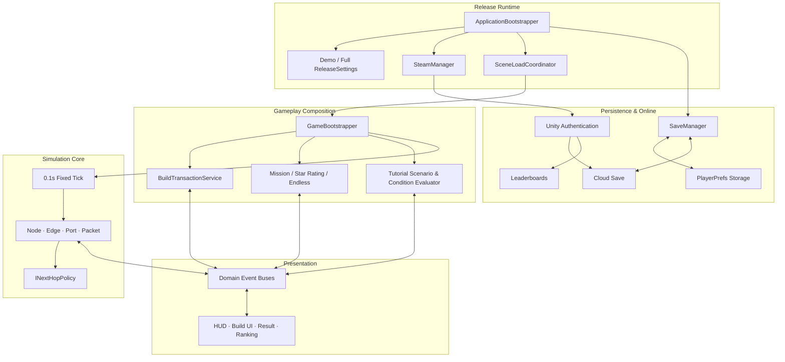
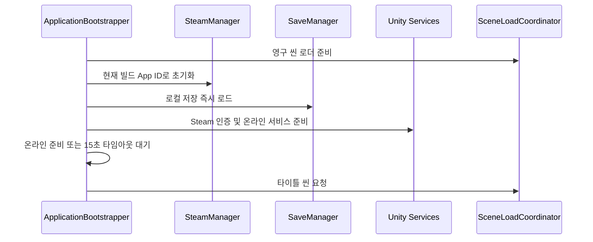

# Architecture

## 설계 목표

Traceroute의 출시 버전은 실시간 네트워크 계산뿐 아니라 데모·본편 빌드 분리, Steam 계정 인증, 클라우드 저장, 비동기 씬 로드와 튜토리얼까지 함께 다룹니다. 핵심 목표는 다음 세 가지입니다.

1. 렌더링 프레임과 무관하게 네트워크 상태를 일관되게 계산한다.
2. 건설·미션·튜토리얼·UI가 시뮬레이션 코어를 직접 침범하지 않게 한다.
3. Steam이나 Unity Gaming Services가 실패해도 로컬 게임플레이는 시작할 수 있게 한다.

## 전체 구조

## 1. 출시 런타임과 초기화 순서

`00_Boot` 씬의 `ApplicationBootstrapper`가 영구 매니저를 명시된 순서로 초기화합니다. 데모와 본편은 `ReleaseSettings`를 공유하되 각기 다른 Steam App ID와 플레이 가능 스테이지 제한을 가집니다.

온라인 초기화가 실패하거나 제한 시간을 넘으면 경고를 남기고 로컬 데이터로 진행합니다. 출시 플랫폼 장애가 게임 시작 자체를 막지 않도록 한 경계입니다.

## 2. 씬 로드와 게임 조립

게임플레이는 공통 `GameCore` 씬과 스테이지 맵 씬을 합성합니다. `SceneLoadCoordinator`가 공통 씬을 먼저 로드하고 맵을 Additive로 추가한 뒤, 모든 `Awake`/`OnEnable`과 맵 등록이 끝난 다음 프레임에 `GameBootstrapper.BeginGame()`을 호출합니다.

`GameBootstrapper`는 선택된 `StageConfigSO`에서 난이도, 스폰, 서버, 맵 확장 설정을 읽어 경제·미션·무한 모드 시스템에 같은 구성 값을 주입합니다. Unity의 우연한 `Start()` 실행 순서 대신 단일 조립 지점을 둔 구조입니다.

## 3. 고정 틱 네트워크 시뮬레이션

`Simulation`은 프레임의 `deltaTime`을 누적하고 기본 0.1초마다 `SimulationEventBus.RaiseTick(dt)`을 발생시킵니다. 노드와 엣지는 같은 시간 단위로 패킷 생성, 큐 처리, 대역폭 사용량과 지연을 갱신합니다.

다음 홉 선택 규칙은 `INextHopPolicy`로 분리했습니다.

- `RoundRobinPolicy`: 후보 경로를 순환 선택
- `BestStatePolicy`: 현재 혼잡 상태가 더 나은 후보 선택
- 노드는 패킷 처리 흐름을 유지한 채 정책만 교체 가능

## 4. 건설 트랜잭션과 영구 그래프

입력 컨트롤러는 드래그 초안과 시각적 미리보기를 소유하고, `BuildTransactionService`는 검증·비용·영구 상태·이벤트를 소유합니다.

케이블 확정 전에는 연결 여부, 사용자 간 직결, 서버 연결 규칙과 예산을 검사합니다. 확정 시에는 `CableGraph`의 셀별 지불 기록, `GridStateService` 점유 상태, 경제 이벤트를 하나의 흐름에서 갱신합니다. 미리보기와 실제 결제가 동일한 `CalculateCableCost`를 사용하므로 표시 금액과 차감 금액이 달라지지 않습니다.

노드 셀은 케이블별로, 일반 셀은 물리 셀당 한 번만 과금합니다. 이 지불 기록은 업그레이드 차액과 부분 철거 환불의 기준으로도 사용됩니다.

## 5. 이벤트 기반 게임·UI 계층

범용 이벤트 허브 대신 역할별 버스를 사용합니다.

| 이벤트 버스 | 책임 |
|---|---|
| `SimulationEventBus` | 틱과 시간 변화 |
| `NetworkEventBus` | 노드·엣지 상태, 전달·유실, 장애 |
| `EconomicEventBus` | 예산 변화 |
| `BuildEventBus` | 건설 모드, 배치·철거 결과 |
| `MissionEventBus` | 목표 진행률과 실패량 |
| `SelectionEventBus` | 노드·엣지 선택 |

HUD, 정보 패널, 튜토리얼은 코어 객체를 계속 폴링하지 않고 필요한 상태 변화를 구독합니다. 구체적인 UI가 시뮬레이션의 의존성이 되지 않으며, 씬 전환 시 구독 수명도 컴포넌트 단위로 관리합니다.

## 6. 실제 상태를 검사하는 튜토리얼

튜토리얼은 버튼 클릭 횟수가 아니라 결과로 만들어진 네트워크를 검사합니다. `TutorialConditionEvaluator`는 그래프 탐색으로 사용자에서 서버까지의 도달 가능성, 색상 일치, 분배기에서 서로 다른 병합 경로가 같은 서버로 합류하는지 확인합니다. 모든 경로가 완성되고 과부하가 기준 이하인 상태가 일정 시간 유지되어야 다음 단계로 진행합니다.

고정 사용자 위치와 병목용 장비 수치는 `TutorialScenarioController`와 `TutorialBalanceConfigSO`로 분리해 재현 가능한 학습 시나리오를 구성합니다.

## 7. Steam 인증과 로컬 우선 저장

Steam Web API 인증 티켓으로 Unity Authentication에 직접 로그인해 `PlayerId`를 Steam 계정에 연결합니다. 에디터 실행, Steam 미실행, 인증 실패 상황에서는 익명 인증으로 폴백합니다.

`SaveManager`는 진행도와 설정을 먼저 로컬에 저장하고, 클라우드 업로드가 필요한 경우 `hasPendingCloudSave`를 표시합니다. 업로드 성공 시 동일 저장 버전일 때만 플래그를 해제하고, 실패하면 로컬 데이터를 유지해 다음 시작에서 재전송합니다. Cloud Save와 Leaderboards가 일시적으로 중단되어도 플레이와 진행도 저장은 계속됩니다.

## 8. 데이터 주도 콘텐츠

`StageConfigSO`는 난이도별 시작 예산, 목표 전송량, 실패 한도, 사용자 스폰과 별 등급 조건을 보관합니다. 장애는 `NetworkIncidentSO` 파생 에셋의 시작·진행·종료 생명주기로 구성합니다. 무한 모드 난이도 역시 별도 설정 에셋으로 주입해 코드 수정 없이 스테이지와 출시 버전의 밸런스를 조정할 수 있습니다.
