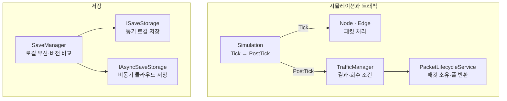
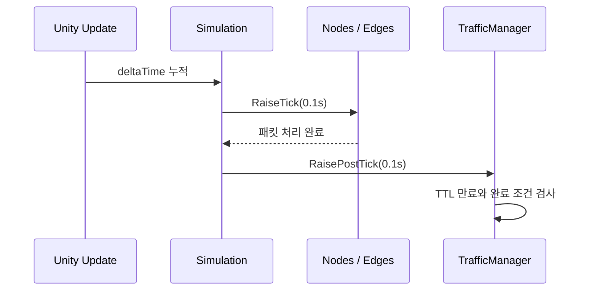
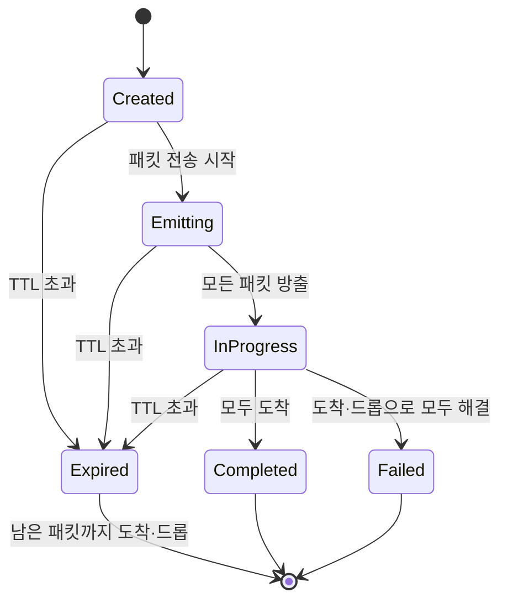
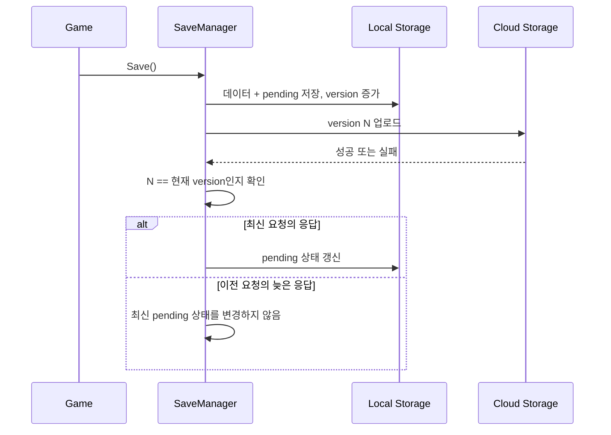

# 책임과 전체 호출 흐름

[게임 소개](../README.md) · [코드 가이드](code-guide.md) · [상세 사례 목차](case-studies.md)

## 설계 목표

이 공개용 문서는 전체 게임 기능을 나열하지 않고 다음 세 가지 경계를 설명합니다.

1. 시뮬레이션 틱 안의 패킷 처리와 만료 검사를 정해진 단계로 실행한다.
2. 트래픽 결과 통지와 패킷 자원 회수는 서로 다른 완료 조건을 가진다.
3. 로컬 저장 완료와 비동기 클라우드 동기화 완료를 구분한다.

## 책임 구조

## 1. 시뮬레이션 단계

`Simulation`은 누적 시간에 따라 0.1초 단위의 `Tick`과 `PostTick`을 호출합니다. 노드와 엣지의 패킷 처리가 끝난 뒤 트래픽 만료를 검사하므로, 같은 틱 안의 처리 순서를 추적할 수 있습니다.

현재 구현은 `if (timer >= fixedDt)`로 프레임당 한 번만 고정 틱을 실행합니다. 긴 프레임 뒤 누락된 틱을 같은 프레임에서 모두 처리하는 catch-up 구조는 아닙니다.

## 2. 트래픽 생명주기

`Expired`는 실패 결과를 통지했다는 뜻이며 즉시 자원을 회수했다는 뜻은 아닙니다. `PacketLifecycleService`가 개별 패킷의 현재 소유와 풀 반환을 담당하고, 모든 패킷이 도착 또는 드롭되어 `Traffic.IsResolved`가 된 뒤에만 트래픽 객체를 반환합니다.

## 3. 저장 흐름

이 버전 비교는 클라이언트의 완료 상태 표시를 보호합니다. 서버 측 조건부 쓰기나 ETag를 사용하지 않으므로, 여러 기기 또는 서버 저장 순서 자체의 충돌 해결 장치는 아닙니다.
