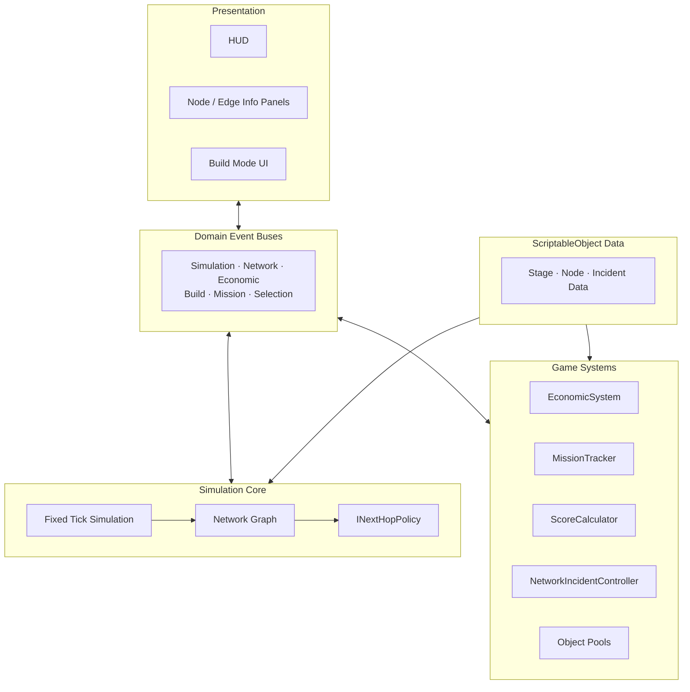
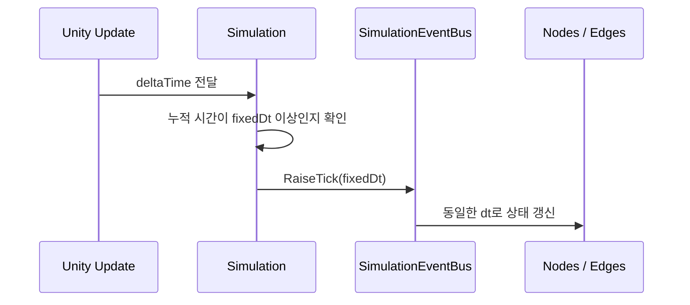

# Architecture

## 목표

EndGame의 핵심 과제는 실시간으로 변화하는 네트워크 상태를 일관되게 계산하면서도 UI, 건설, 미션, 장애 이벤트를 독립적으로 확장할 수 있는 구조를 만드는 것이었습니다.

## 전체 구조

## 1. 고정 틱 시뮬레이션

`Simulation`은 프레임의 `deltaTime`을 누적하고 기본 0.1초 단위로 `Tick`을 발생시킵니다. 노드와 엣지는 `SimulationEventBus.OnTick`을 구독해 같은 시간 단위로 상태를 갱신합니다.

이 방식은 렌더링 프레임과 게임 규칙의 시간축을 분리하고, 배속 변화 속에서도 패킷 처리 순서를 추적하기 쉽게 합니다.

## 2. 네트워크 그래프와 정책 분리

그래프 계층은 노드·엣지·포트의 연결 상태와 패킷 이동을 담당합니다. 다음 홉을 선택하는 규칙은 `INextHopPolicy`로 분리했습니다.

- `RoundRobinPolicy`: 후보 경로를 순환 선택
- `BestStatePolicy`: 현재 상태가 더 나은 후보 선택
- 노드 구현은 구체적인 라우팅 알고리즘을 알 필요가 없음

새 정책을 추가할 때 노드의 전송 흐름을 수정하지 않아도 되는 것이 핵심입니다.

## 3. 도메인 이벤트 버스

하나의 범용 이벤트 허브 대신 역할별 버스를 사용합니다.

| 이벤트 버스 | 책임 |
|---|---|
| `SimulationEventBus` | 틱과 시간 변화 |
| `NetworkEventBus` | 노드·엣지 상태, 패킷 전달·유실, 장애 |
| `EconomicEventBus` | 예산 변화 |
| `BuildEventBus` | 건설 모드, 배치·삭제 결과 |
| `MissionEventBus` | 목표 진행률과 실패량 |
| `SelectionEventBus` | 노드·엣지 선택 |

UI는 코어 객체를 직접 폴링하지 않고 필요한 이벤트를 구독합니다. 새 패널이나 튜토리얼 반응을 추가할 때 시뮬레이션 코어의 참조 관계가 커지는 것을 줄였습니다.

## 4. 데이터 주도 장애 시스템

`NetworkIncidentSO`를 기반으로 DDoS, 트래픽 버스트, 링크 장애를 개별 ScriptableObject 구현으로 분리했습니다. 공통 생명주기는 다음과 같습니다.

1. `OnStarted`에서 대상과 초기 효과 적용
2. `OnProgress`에서 지속 효과 갱신
3. `OnEnded`에서 변경 상태 복구

장애 종류와 스테이지 구성을 에셋으로 관리해 코드와 밸런스 데이터를 분리했습니다.

## 5. 게임 시스템과 외부 서비스

경제, 미션, 점수, 저장과 랭킹은 시뮬레이션 그래프와 별도 시스템으로 구성했습니다. 스테이지 결과는 Unity Cloud Save와 Leaderboards에 연결되며, 서비스가 연결되지 않은 환경에서도 핵심 게임플레이는 동작하도록 랭킹 UI를 선택적으로 비활성화합니다.

